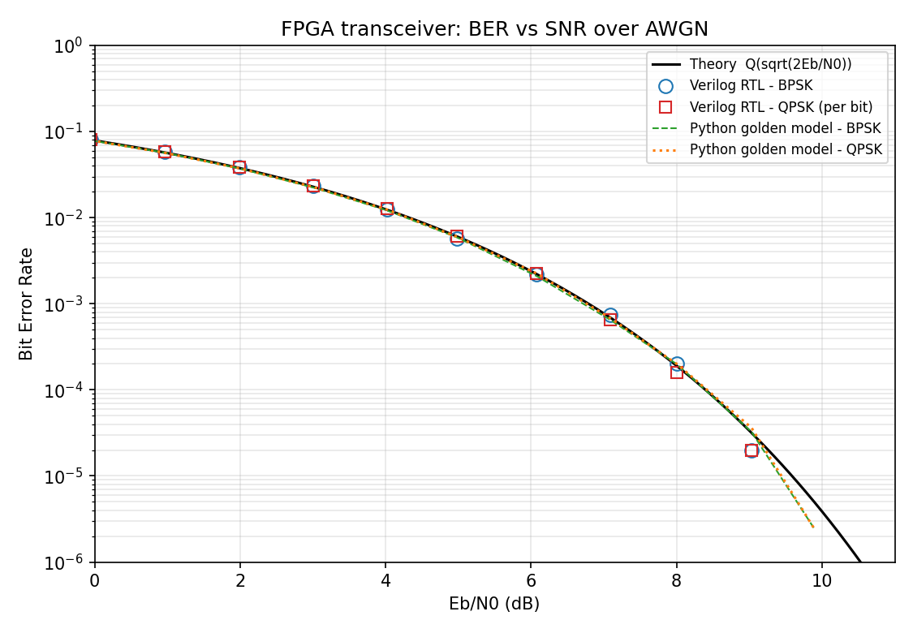

# FPGA-Based Digital Communication Transceiver

**Verilog HDL · AMD Vivado · MATLAB / Python**

A complete digital communication link implemented in synthesizable Verilog:
**BPSK** modulation with **coherent demodulation**, an on-chip **AWGN channel**,
a hardware **BER counter**, BER-vs-SNR analysis, and an extension to **QPSK**
for 2× spectral efficiency.

```
 PRBS-15 ─► BPSK/QPSK ─► (+) AWGN ─► × local carrier ─► Integrate&Dump ─► Decision ─► BER counter
  source     modulator      ▲          (coherent mixer)                                  ▲
                         noise_gain                                                 Tx bits (delay-matched)
```

## Results (RTL simulation, 100 k symbols / SNR point)



| Eb/N0 (dB) | BPSK BER (RTL) | QPSK BER/bit (RTL) | Theory Q(√(2Eb/N0)) |
|---|---|---|---|
| 0  | 8.10e-02 | 8.05e-02 | 7.98e-02 |
| 2  | 3.83e-02 | 3.82e-02 | 3.77e-02 |
| 4  | 1.26e-02 | 1.28e-02 | 1.24e-02 |
| 6  | 2.22e-03 | 2.26e-03 | 2.22e-03 |
| 8  | 2.00e-04 | 1.60e-04 | 1.89e-04 |
| 9  | 2.00e-05 | 2.00e-05 | 3.17e-05 |
| 10 | 0 errors (below sim floor) | 0 | 5e-06 |

The hardware simulation tracks theory within statistical error; QPSK achieves the
same per-bit BER as BPSK while carrying twice the bits per symbol. See
`docs/constellations.png` and `docs/theory.md`.

## Repository layout
| Path | Content |
|---|---|
| `rtl/prbs15.v` | PRBS-15 data source |
| `rtl/carrier_lut.v` | 8-point cos/sin carrier ROM |
| `rtl/awgn_gen.v` | Synthesizable Gaussian noise (xorshift32 ×3 + CLT) |
| `rtl/bpsk_transceiver.v` | BPSK mod → AWGN → coherent demod → BER counters |
| `rtl/qpsk_transceiver.v` | QPSK I/Q extension |
| `rtl/fpga_top.v` | Board demo top (switches select SNR/mode, LEDs show errors) |
| `tb/` | `tb_ber_sweep.v` (0–10 dB sweep → CSV), `tb_bpsk_wave.v` (VCD) |
| `python/`, `matlab/` | BER plots, floating-point golden model, constellations |
| `vivado/create_project.tcl`, `constraints/basys3.xdc` | Vivado project + Basys-3 pins |

## How to run
**Open-source (Icarus Verilog + Python)**
```bash
make sweep      # RTL BER sweep -> sim/ber_results.csv   (takes a few minutes)
make plot       # docs/ber_curve.png, docs/constellations.png
make wave       # quick sanity run + VCD
```
**Vivado**
```bash
vivado -mode batch -source vivado/create_project.tcl
# then: Run Simulation (top = tb_ber_sweep), Run Synthesis/Implementation (top = fpga_top)
```
Python needs `numpy scipy matplotlib`. MATLAB: run `matlab/ber_analysis.m` from the repo root.

## Hardware demo
On a Basys-3: `sw[3:0]` = Eb/N0 (0–10 dB), `sw[4]` BPSK/QPSK, `sw[5]` low/high half of the
error counter on `led[15:0]`, `btnC` = reset. Use an ILA/VIO to read `bit_count`/`err_count`.

## Future work
Carrier/timing recovery (Costas loop, Gardner), pulse shaping (RRC), 16-QAM, FEC (convolutional/LDPC).
